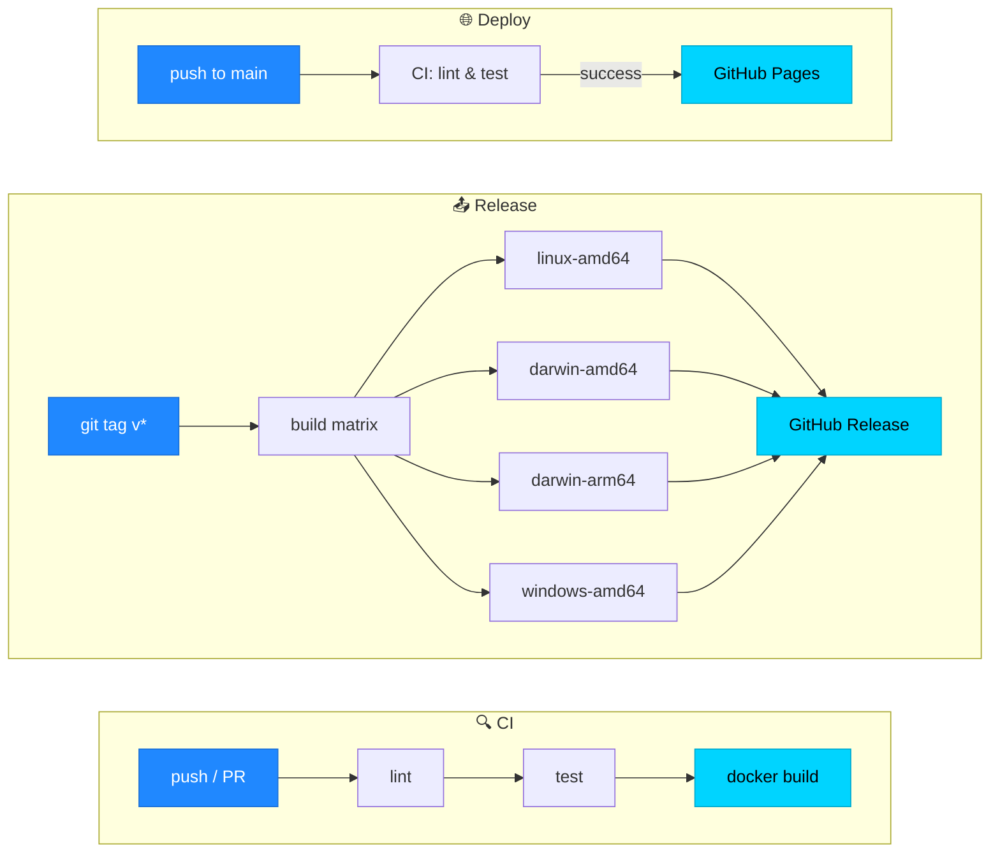

 

  

<b>
<a href="#deploy">🚀 Deploy</a> &nbsp;•&nbsp;
<a href="#fullstack">🎬 Фуллстек</a> &nbsp;•&nbsp;
<a href="#gui">🆕 GUI</a> &nbsp;•&nbsp;
<a href="#core">📦 Основные</a> &nbsp;•&nbsp;
<a href="#other">🗂️ Остальные</a> &nbsp;•&nbsp;
<a href="#pipelines">⚙️ Пайплайны</a>
</b>

 

## 📊 В цифрах

| 🗃️ Репозиториев | 🧬 Языков и стеков | 🖥️ Платформ для бинарников | 🔁 Типов пайплайнов |
|:---:|:---:|:---:|:---:|
| **21** | **10+** | **4** | **3** |
| учебные и боевые | Go · Rust · PHP · C++ · C# · TS · Python · Java · JS | Linux · macOS (Intel + ARM) · Windows | CI · Release · Deploy |

---

## 🚀 CI/CD (Deploy)

> Полноценный Continuous Deployment: автоматические проверки и публикация на **GitHub Pages**.

| Проект | Стек | Что делает | Пайплайн | Ссылка |
|:---|:---|:---|:---|:---:|
| ⚡ **cyberpunk-pages** |  | Многостраничный фан-сайт Cyberpunk 2077 с глитч-анимациями | `lint` → `deploy to Pages` | [**открыть →**](https://github.com/ChrisRedfield48/cyberpunk-pages) |
| 🚀 **hello-pages** |    | SPA-приложение с покрытием тестами | `lint` → `type-check` → `test` → `build` → `deploy` | [**открыть →**](https://github.com/ChrisRedfield48/hello-pages) |

---

## 🎬 Фуллстек веб-приложения

> Клиент-серверная архитектура, база данных и контейнеризация.

| Проект | Стек | Что делает | Пайплайн | Ссылка |
|:---|:---|:---|:---|:---:|
| 🎬 **my-videoeditor** |     | Форк AI-видеоредактора **Kimu**, адаптированный для локального запуска: правки под Postgres 18, Nginx и Cloudflare R2 | `format-check` → _build в разработке_ | [**открыть →**](https://github.com/ChrisRedfield48/my-videoeditor) |

---

## 🆕 GUI-проекты · Go + Fyne

> Кроссплатформенные десктопные приложения. Бинарники публикуются в **GitHub Releases** по тегу `v*`.

| Проект | Стек | Что делает | Пайплайн | Ссылка |
|:---|:---|:---|:---|:---:|
| 🛠 **arduino-manager-gui** |   | Менеджер Arduino-библиотек и ядер с поиском по GitHub | `matrix build` → `release` (4 платформы) | [**открыть →**](https://github.com/ChrisRedfield48/arduino-manager-gui) |
| ⚡ **hex-loader** |   | Загрузчик HEX-файлов в Arduino через `arduino-cli` | `matrix build` → `release` (4 платформы) | [**открыть →**](https://github.com/ChrisRedfield48/hex-loader) |
| 🎨 **hello-gui** |   | Учебное GUI-приложение с автодеплоем бинарников | `matrix build` → `release` | [**открыть →**](https://github.com/ChrisRedfield48/hello-gui) |

🐧 Linux &nbsp;·&nbsp; 🍎 macOS Intel &nbsp;·&nbsp; 🍏 macOS ARM &nbsp;·&nbsp; 🪟 Windows

---

## 📦 Основные CI/CD-проекты

> Пять репозиториев, пять языков, один и тот же подход: **lint → test → build**.

| Проект | Язык | Пайплайн | Ссылка |
|:---|:---|:---|:---:|
| 🐹 **my-go-app** |  | `vet` → `test` → `docker build` | [**открыть →**](https://github.com/ChrisRedfield48/my-go-app) |
| 🦀 **my-rust-app** |  | `clippy` → `test` → `docker build` | [**открыть →**](https://github.com/ChrisRedfield48/my-rust-app) |
| 🐘 **my-php-app** |  | `lint` → `phpunit` → `docker build` | [**открыть →**](https://github.com/ChrisRedfield48/my-php-app) |
| ⚙️ **my-cpp-app** |  | `clang-format` → `gtest` → `docker build` | [**открыть →**](https://github.com/ChrisRedfield48/my-cpp-app) |
| 🎯 **hello-csharp** |  | `test` → **release** (matrix-бинарники) | [**открыть →**](https://github.com/ChrisRedfield48/hello-csharp) |

---

## 🗂️ Остальные репозитории

> Учебные проекты, где я тренировался в отдельных технологиях. Пайплайны упрощённые или отсутствуют.

<b>📂 Показать все 10 репозиториев</b>

 

| Проект | Стек | Ссылка |
|:---|:---|:---:|
| 🌌 **hello-static** | HTML + CSS + JS | [открыть →](https://github.com/ChrisRedfield48/hello-static) |
| 🐍 **hello-python** | Python | [открыть →](https://github.com/ChrisRedfield48/hello-python) |
| 🐍 **my-python-app** | Python | [открыть →](https://github.com/ChrisRedfield48/my-python-app) |
| 🐹 **hello-go** | Go | [открыть →](https://github.com/ChrisRedfield48/hello-go) |
| 🐹 **hello-go-releases** | Go | [открыть →](https://github.com/ChrisRedfield48/hello-go-releases) |
| 🦀 **hello-rust** | Rust | [открыть →](https://github.com/ChrisRedfield48/hello-rust) |
| 🦀 **my-rust-app2** | Rust · Dockerfile | [открыть →](https://github.com/ChrisRedfield48/my-rust-app2) |
| ☕ **hello-java** | Java | [открыть →](https://github.com/ChrisRedfield48/hello-java) |
| 🟩 **my-node-app** | JavaScript · Node.js | [открыть →](https://github.com/ChrisRedfield48/my-node-app) |
| 🧪 **my-first-cicd** | первый эксперимент с CI/CD | [открыть →](https://github.com/ChrisRedfield48/my-first-cicd) |

---

## ⚙️ Как устроены пайплайны

<table>
<tr>
<td width="33%" valign="top">

### 🔍 CI
**Основные 5 проектов**

- Триггер: `push` и `pull_request`
- Линтинг под свой стек
- Прогон unit-тестов
- Сборка Docker-образа

</td>
<td width="33%" valign="top">

### 📤 Release
**GUI-проекты и `hello-csharp`**

- Триггер: git-тег `v1.0.0`
- Матричная сборка бинарников
- Автопубликация в GitHub Releases

</td>
<td width="33%" valign="top">

### 🌐 Deploy
**Pages-проекты**

- Триггер: `push` в `main`
- Линтинг (и тесты для SPA)
- Публикация статики или `dist/` в GitHub Pages

</td>
</tr>
</table>

### 🧭 Общая схема

---

### 👤 [ChrisRedfield48](https://github.com/ChrisRedfield48)

Кликни по названию проекта в любой таблице — попадёшь в репозиторий с кодом, README и историей запусков workflow.

  

