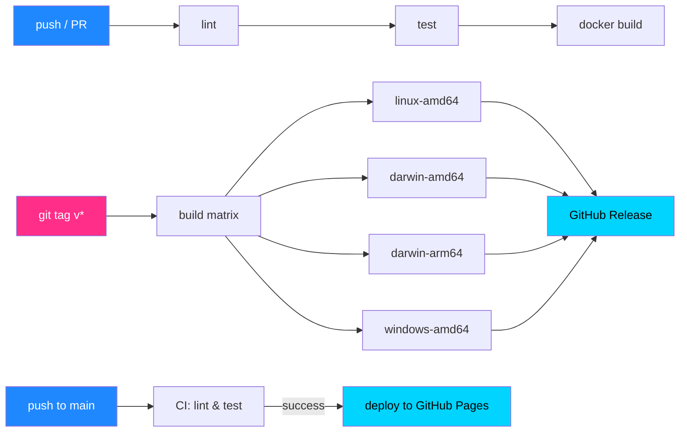

# 🚀 CI/CD Learning Projects

  <b>Пять языков. Пять пайплайнов. Один принцип: push → lint → test → build.</b>

  
  

---

## 🌐 Статические сайты и SPA (GitHub Pages)

> Проекты с автоматическим деплоем на GitHub Pages (Environments + Deployments). Без сборки или со сборкой, но всегда с гейтингом `needs: ci`.

| Проект | Стек | Что делает | CI/CD | Репозиторий |
|---|---|---|---|---|
| ⚡ **cyberpunk-pages** | HTML + CSS + JS | Многостраничный фан-сайт Cyberpunk 2077 с глитч-анимациями | lint → deploy to Pages | [открыть →](https://github.com/ChrisRedfield48/cyberpunk-pages) |
| 🚀 **hello-pages** | React + TS + Vite | SPA-приложение с покрытием тестами | lint → type-check → test → build → deploy | [открыть →](https://github.com/ChrisRedfield48/hello-pages) |
| 🌌 **hello-static** | HTML + CSS + JS | Многостраничный сайт с интерактивным 3D-фоном | lint → deploy to Pages | [открыть →](https://github.com/ChrisRedfield48/hello-static) |

---

## 🆕 Новые GUI-проекты (Go + Fyne)

> Кроссплатформенные десктопные приложения с публикацией бинарников в GitHub Releases.

| Проект | Стек | Что делает | CI/CD | Репозиторий |
|---|---|---|---|---|
| 🛠 **arduino-manager-gui** | Go + Fyne | Менеджер Arduino-библиотек и ядер с поиском по GitHub | matrix build → release (4 платформы) | [открыть →](https://github.com/ChrisRedfield48/arduino-manager-gui) |
| ⚡ **hex-loader** | Go + Fyne | Загрузчик HEX-файлов в Arduino через arduino-cli | matrix build → release (4 платформы) | [открыть →](https://github.com/ChrisRedfield48/hex-loader) |
| 🎨 **hello-gui** | Go + Fyne | Учебное GUI-приложение с автодеплоем бинарников | matrix build → release | [открыть →](https://github.com/ChrisRedfield48/hello-gui) |

> Все три проекта собираются под **Linux / macOS (Intel + ARM) / Windows** и публикуются в **GitHub Releases** по тегу `v*`.

---

## 📦 Основные CI/CD-проекты

> Пять репозиториев с полноценным пайплайном **lint → test → build**. Каждый — на своём языке.

| Проект | Стек | Пайплайн | Репозиторий |
|---|---|---|---|
| 🐹 **my-go-app** | Go | vet → test → docker build | [открыть →](https://github.com/ChrisRedfield48/my-go-app) |
| 🦀 **my-rust-app** | Rust | clippy → test → docker build | [открыть →](https://github.com/ChrisRedfield48/my-rust-app) |
| 🐘 **my-php-app** | PHP | lint → phpunit → docker build | [открыть →](https://github.com/ChrisRedfield48/my-php-app) |
| ⚙️ **my-cpp-app** | C++ / CMake | clang-format → gtest → docker build | [открыть →](https://github.com/ChrisRedfield48/my-cpp-app) |
| 🎯 **hello-csharp** | C# / .NET | test → **release** (matrix binaries) | [открыть →](https://github.com/ChrisRedfield48/hello-csharp) |

---

## 🗂️ Остальные репозитории

> Учебные проекты, где я тренировался в отдельных технологиях. Пайплайны упрощённые или отсутствуют.

| Проект | Стек | Репозиторий |
|---|---|---|
| 🐍 **hello-python** | Python | [открыть →](https://github.com/ChrisRedfield48/hello-python) |
| 🐍 **my-python-app** | Python | [открыть →](https://github.com/ChrisRedfield48/my-python-app) |
| 🐹 **hello-go** | Go | [открыть →](https://github.com/ChrisRedfield48/hello-go) |
| 🐹 **hello-go-releases** | Go | [открыть →](https://github.com/ChrisRedfield48/hello-go-releases) |
| 🦀 **hello-rust** | Rust | [открыть →](https://github.com/ChrisRedfield48/hello-rust) |
| 🦀 **my-rust-app2** | Rust / Dockerfile | [открыть →](https://github.com/ChrisRedfield48/my-rust-app2) |
| ☕ **hello-java** | Java | [открыть →](https://github.com/ChrisRedfield48/hello-java) |
| 🟩 **my-node-app** | JavaScript / Node.js | [открыть →](https://github.com/ChrisRedfield48/my-node-app) |
| 🧪 **my-first-cicd** | — | [открыть →](https://github.com/ChrisRedfield48/my-first-cicd) |

---

## ⚙️ Как устроены пайплайны

### 🔍 CI — в основных пяти проектах

- Триггер: `push` и `pull_request`
- Статический анализ / линтинг под свой стек
- Прогон unit-тестов
- Сборка Docker-образа приложения

### 📤 Release — в GUI-проектах и `hello-csharp`

- Триггер: push git-тега (`v1.0.0` и т.п.)
- Матричная сборка self-contained бинарников
- Автопубликация в GitHub Releases

### 🌐 Deploy to Pages — в статических сайтах и SPA

- Триггер: `push` в ветку `main`
- Линтинг (и тесты для SPA)
- Прямая публикация статики (или папки `dist/`) в GitHub Pages

### Диаграмма пайплайнов

---

## 🧭 Навигация

> Кликни по названию проекта в любой таблице — попадёшь прямо в репозиторий с полным README, кодом и историей запусков workflow.

### 👤 [ChrisRedfield48](https://github.com/ChrisRedfield48)

---

  <a href="https://github.com/ChrisRedfield48?tab=repositories">📂 Все репозитории</a> ·
  <a href="https://github.com/ChrisRedfield48?tab=repositories&type=source">🛠 Проекты</a> ·
  <a href="https://github.com/ChrisRedfield48?tab=stars">⭐ Избранное</a>

